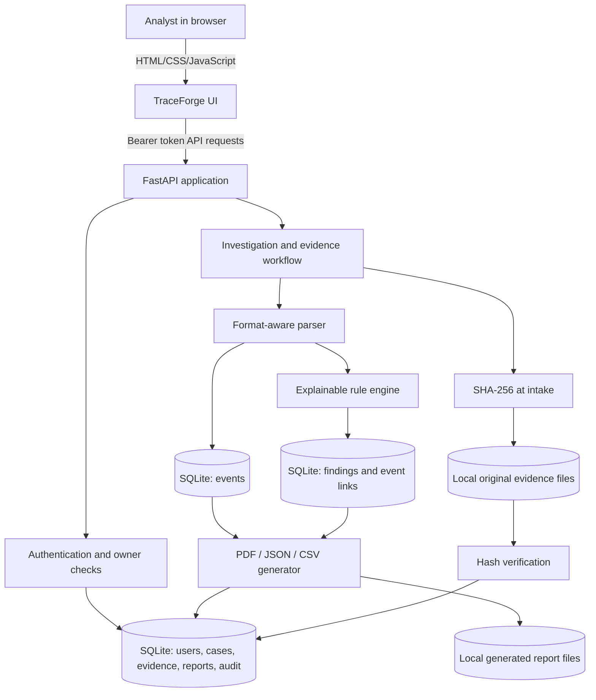
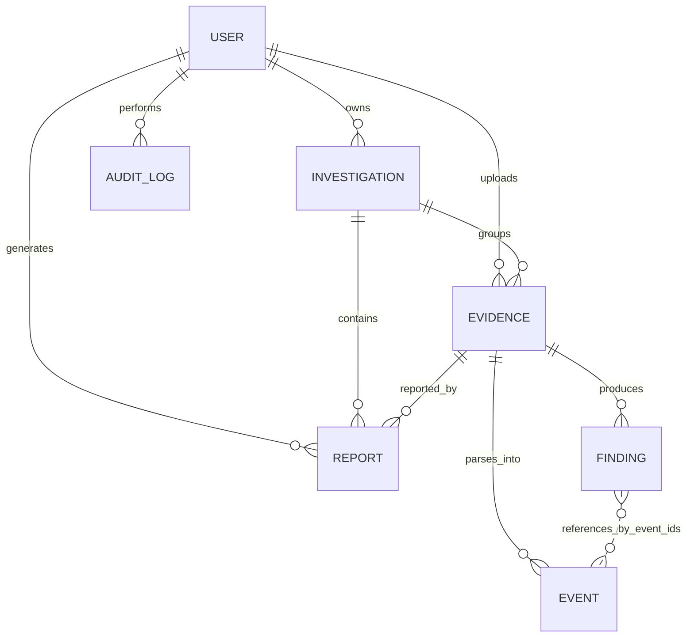

# TraceForge Architecture and Data Flow

## High-level architecture

## Core design decisions

- FastAPI serves both the static single-page UI and API; there is no separate Node build.
- SQLAlchemy maps users, investigations, evidence, parsed events, findings, generated reports and audit entries.
- SQLite and local files keep the college-demo setup straightforward. `data/` is local runtime state and is excluded from source control.
- Each protected query is scoped to the authenticated owner. Evidence and report downloads return `404` when the record does not belong to the requester, avoiding cross-account disclosure.
- Original uploaded bytes remain separate from parsed event rows. Findings retain actual persisted event IDs, rather than temporary list offsets.
- Report history records generated output metadata; the files are stored under `data/reports/` and can be downloaded again.
- The startup upgrade is additive for the previous SQLite schema: new columns/tables are added and existing unassigned evidence is grouped into a migration case. It does not drop the existing database.

## Data model (ER diagram)

`Finding.event_ids` is a JSON-encoded list of persisted `Event.id` values. This explicit reference makes the finding explainable and lets the UI/report show which source events triggered it.

## Processing sequence

1. Authenticate the account and verify the selected case belongs to that account.
2. Validate file extension, configured byte limit and exact-content duplicate hash.
3. Store the original under a random server-generated filename and record its SHA-256 reference.
4. Parse supported source records, normalize recognized timestamps to UTC and count parsing gaps.
5. Persist events, evaluate deterministic rules and link each finding to actual event row IDs.
6. Record the processing outcome in the audit trail and expose evidence details/timeline.
7. When requested, generate PDF/JSON/CSV output from persisted records, save the output file and add a report-history row.

## Security and operational boundaries

The project is intended for a local educational demo. Production use would need HTTPS, deployment-level rate limiting, formal versioned migrations, backups and recovery testing, managed secrets, host/file-system protections, privacy/retention controls, monitoring, and independent security review. SHA-256 is an integrity comparison against an intake reference, not proof of authenticity or a full chain of custody.
